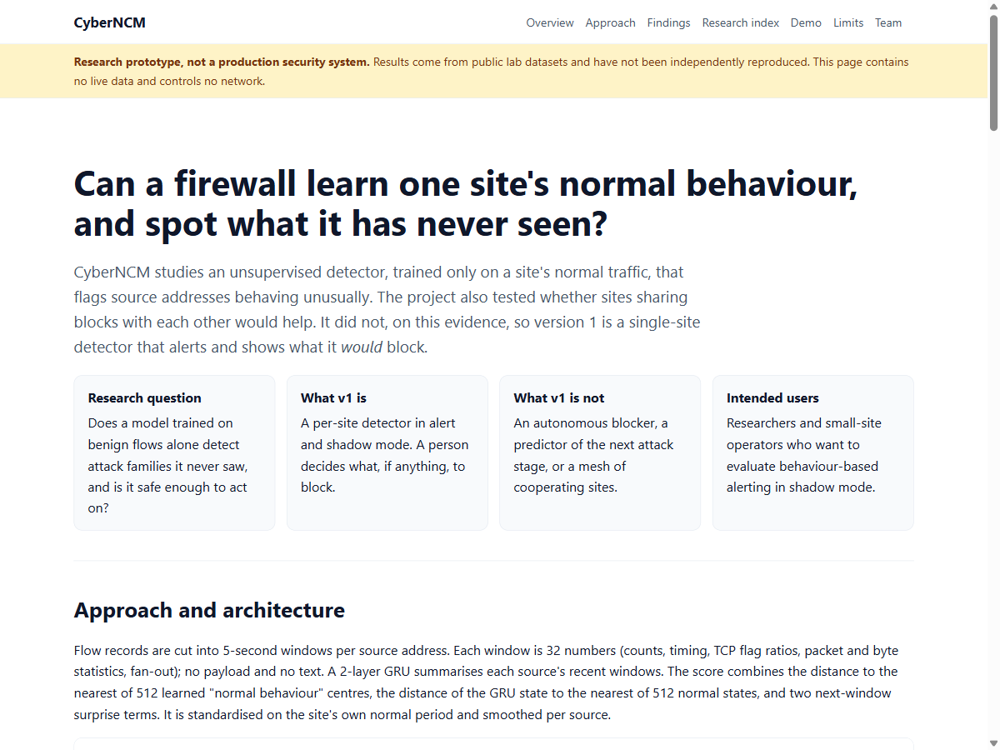
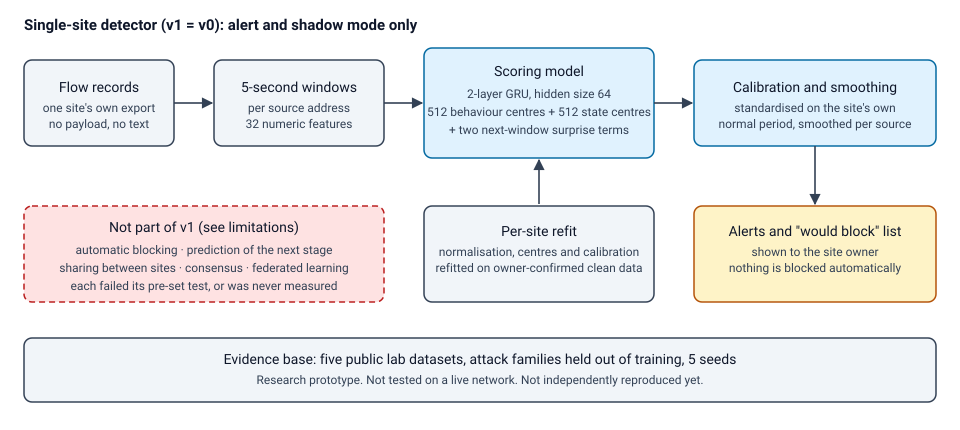
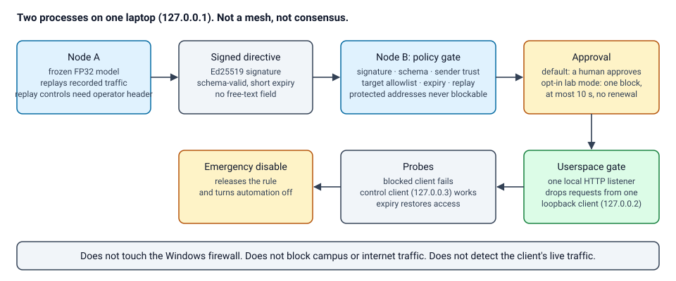
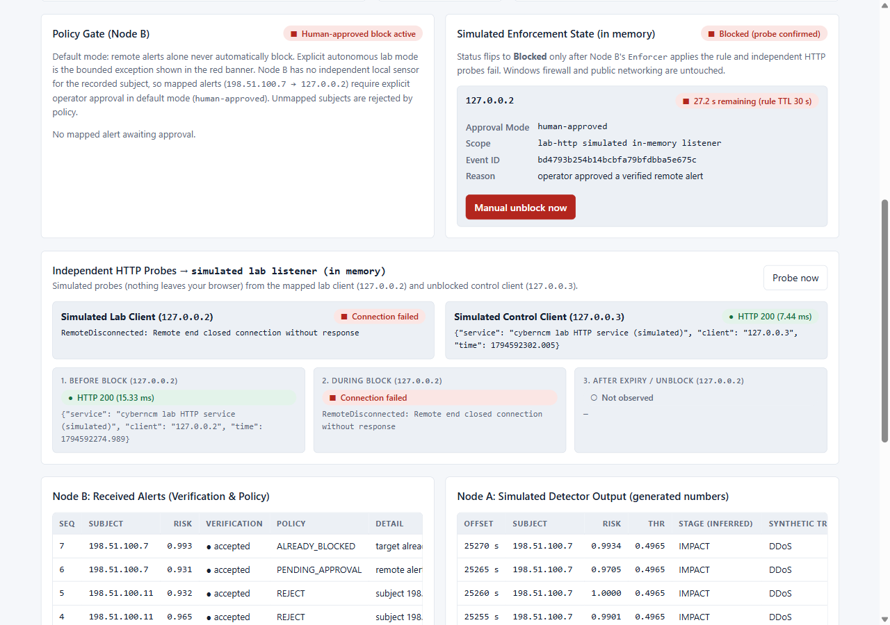
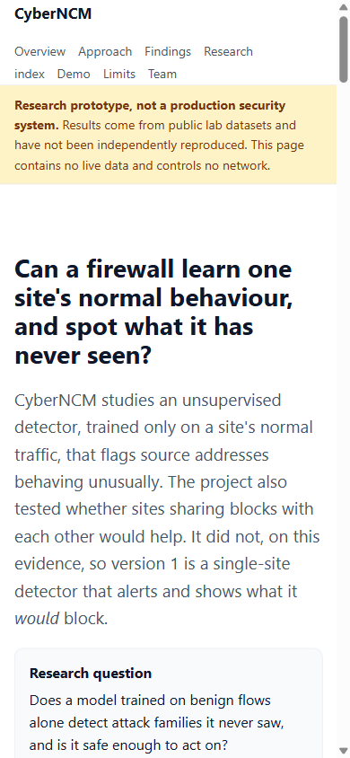
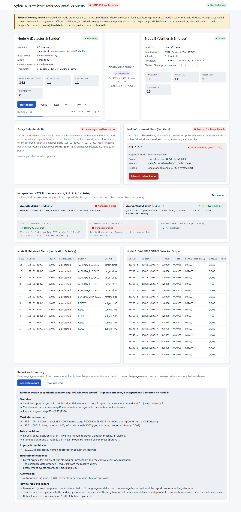

# CyberNCM

**A research prototype that learns one network's normal behaviour from flow records and flags source addresses behaving unusually, together with an honest record of every research round, including the negative and unfinished ones.**

> **Status: research prototype, not a production security system.** It was evaluated on public lab datasets, has not been run on a live network, and no independent person has reproduced its results yet. Use it for research and for evaluation in *shadow mode* (alert, do not block).

Authors: **Rohan Sai, Yuvashree C and Sonia C**.



**Public demo:** https://rohan-ktksu.github.io/cyberncm/ (static page with an in-browser simulation on synthetic data; it controls nothing and makes no network requests). Deployed and checked on 13 November 2026. It can also be opened locally: `cd site && python -m http.server 8000`, then visit `http://127.0.0.1:8000`.

## Contents

1. [Purpose and intended users](#purpose-problem-and-intended-users)
2. [What NCM is, and what we took from it](#what-ncm-is-and-what-we-took-from-it)
3. [What v1 does and does not do](#what-v1-does-and-does-not-do)
4. [Method](#method)
5. [Architecture and workflow](#architecture-and-workflow)
6. [The website and its simulation](#the-website-and-its-simulation)
7. [Local setup, launch and troubleshooting](#local-setup)
8. [Human-approved mode and autonomous lab mode](#local-two-node-demo-human-approved-mode-and-autonomous-lab-mode)
9. [Research index](#research-index)
10. [Evaluation metrics and how to read them](#evaluation-metrics-and-how-to-read-them)
11. [Reproduction, dataset provenance and artifact access](#reproduction-dataset-provenance-and-artifact-access)
12. [Threat model and security boundaries](#threat-model-and-security-boundaries)
13. [Citations, code links and licences](#citations-code-links-and-licences)
14. [Roadmap](#roadmap)
15. [Team, licence and security reports](#team-licence-and-security-reports)

## Purpose, problem and intended users

**Problem.** Signature-based network defences miss attacks they have not seen. A detector trained only on a site's *normal* traffic could in principle flag the unfamiliar, but it risks raising too many false alerts, drifting as traffic changes, and being poisoned if the "normal" period contains an attack.

**What we did.** We built a detector (called v0, shipped unchanged as v1) and ran a pre-registered series of research rounds against it: does it generalise to attacks it never saw, can it predict the next stage of an attack, is it safe to block automatically, does sharing blocks between sites help, can it be fooled. Each round's method and pass rule were committed before its results, and failures are reported as failures.

**Intended users.** Researchers and small-site operators who want to evaluate behaviour-based alerting in shadow mode, and readers who want a worked example of reporting negative results.

## What NCM is, and what we took from it

**NCM stands for Next-Context Model** (the source architecture report calls it "Next-Context Modeling"). The idea is not new: learn what normally comes next from a source's benign history, and treat what is *surprising* as suspicious. Related published work is listed in [`ncm/README.md`](ncm/README.md) (some of those entries are marked there as from memory and not re-checked). The architecture report that proposed using it inside a "decentralized predictive firewall mesh" is a project source document and is **not included** in this repository.

**CyberNCM is our prototype of that agent, plus a test of every claim around it.** We built the model, trained it only on benign traffic, and then measured which parts of the idea hold up.

| Part of the NCM idea | What we did with it | What the evidence said |
|---|---|---|
| Learn normal behaviour from benign traffic only, no attack labels | **Kept.** The detector never sees an attack label | Works on held-out attack families at family-mean AUC 0.89 to 0.99 on four lab datasets, 0.70 on a fifth |
| Read a source's recent windows as context (a recurrent model over per-source windows) | **Kept.** A 2-layer GRU over 5-second, 32-feature windows | Clearly useful on one dataset (Unraveled); on three others a simpler distance score is within 0.003 AUC, and on the fifth the GRU is 0.14 worse |
| A vocabulary of "normal behaviour" tokens | **Kept.** 512 behaviour centres and 512 state centres | This is the part that carries most of the signal |
| Score by next-step surprise | **Kept as two terms, at half weight** | **Not supported as the main signal.** Next-context surprise alone was the weakest score and unstable across seeds |
| A risk score that combines surprise with a supervised stage head (the report's R = αS + (1−α)H) | **Built and measured** in the original prototype; the local demo's alert risk comes from it | The head needs labelled attack families. In the demo it had seen the replayed families, so the demo is an illustration of the control flow, not zero-day evidence; the held-out-family tables are. The research detector v1 (= v0) uses the unsupervised score only |
| Kill-chain stage labels in the alert | **Kept, with a change:** we added an `IMPACT` stage because denial of service fits none of the report's five | No example of `EXFILTRATION` exists in the CIC-IDS2017 data used, so the head can never output it |
| Signed, schema-valid directives with short expiry | **Kept and built** in the two-node demo (Ed25519 signatures, JSON schema, hard block caps) | Demonstrates the control flow only; see the demo limits |
| Safeguards: shadow mode first, short expiry, protected addresses, two-peer corroboration | **Kept:** shadow mode, short expiry and protected addresses; human approval is the default and an explicit lab mode allows one 10-second block. **Two-peer corroboration is not built** (the demo has one detector) | Needed: thresholds drifted and false alerts are common |
| **Predicting the next attack stage** | Tested (R2, R13) | **Not supported.** The attacker was flagged in the hour before only 1, 1 and 2 of 6 testable stage onsets |
| **Sharing blocks between sites, consensus, federated learning** | Simulated (R12); R12b to test the block rule is incomplete | **Not supported.** Sharing sped the first block but spread false alerts, and a lying site was not stopped |
| **Automatic blocking** | Tested (R4) | **Not supported.** No policy met the pre-set false-alert target |
| The report's sub-250 ms reaction time | Not attempted | Needs packet-level features; we used flow records and 5-second windows |
| The report's own figures | **Not reproduced and not used.** Every number here comes from our runs in `research/` | See `research/CLAIMS.md`, row N8 |

**In one sentence:** we kept the benign-only, context-aware, vocabulary-based detector and the safety-first message design, and we dropped, or are not claiming, the parts of the NCM idea (next-stage prediction, sharing and automatic blocking) that our own tests did not support.

## What v1 does and does not do

| v1 does | v1 does not |
|---|---|
| Build 5-second, 32-feature windows per source address from flow records | Read packet payloads or free text |
| Score each window against that site's own normal behaviour and flag unusual sources | Block anything automatically in the single-site product |
| Show alerts and a signed "would block" list in shadow mode | Predict the next attack stage (tested, not supported) |
| Refit normalisation, centres and calibration on a site's own normal traffic | Share blocks between sites, reach consensus or learn jointly (tested in simulation, not supported) |
| Ship a local two-node demonstration of signed directives passing a policy gate | Detect live traffic in that demonstration (it replays recorded traffic) |
| Write a plain-language report of a demo run from structured fields, using fixed templates | Use a language model, read message text, or let the report influence any decision |

**Explicit non-goals:** production deployment, automatic enforcement on real networks, a mesh or federated-learning feature, a claim of robustness to adversaries.

## Method

1. **Flow features.** Flow records are cut into 5-second windows per source address. Each window is 32 numbers: counts, timing, TCP flag ratios, packet and byte statistics and fan-out. No payload, no text (`ncm/prep.py`).
2. **GRU and codebooks.** A 2-layer GRU (hidden size 64, 96,070 parameters) summarises each source's recent windows. Two codebooks of 512 learned centres describe "normal behaviour" (window space) and "normal states" (GRU state space) (`ncm/ncm.py`).
3. **Scoring.** The score is the distance to the nearest behaviour centre plus the distance of the GRU state to the nearest state centre plus half of two next-window surprise terms.
4. **Calibration.** Each term is standardised on a calibration period of the site's own normal traffic and smoothed per source. The threshold is set per site; a threshold carried between networks or periods does not hold (R1, R2).
5. **Signed directives (demo).** When Node A's score for a subject crosses its threshold it emits a directive: schema-valid JSON (`demo/two_node/schema/ncm-threat-directive-1.2.0.json`), no free-text field, a short expiry and a monotonic sequence number, signed with Ed25519.
6. **Policy gate (demo).** Node B accepts a directive only if the signature verifies against its trust file, the schema validates, the sender is trusted, the target is on the allowlist, it has not expired or been replayed, and the target is not a protected address. Test-injection messages are verified but never acted on.
7. **Enforcement (demo).** A userspace gate on one local HTTP listener drops requests from one allowlisted loopback client. Blocks have a hard cap and expire on a monotonic clock.

The model card is [`MODEL_CARD.md`](MODEL_CARD.md); the list of what may and may not be said is [`research/CLAIMS.md`](research/CLAIMS.md).

## Architecture and workflow





## The website and its simulation

The website in [`site/`](site/) is a single static page: overview, approach, findings, the full research index, an in-browser simulation, and limitations. It makes no network requests and sets no cookies.





*Captured from the running site: desktop overview, the simulation with its report, and phone width.*

The simulation is **synthetic and clearly labelled**: it runs only in the visitor's browser on generated numbers, uses no dataset and no research model, and cannot affect any machine. It is an illustration of the control flow, not recorded playback and not enforcement. The public site never exposes the demo's Node A or Node B services, operator endpoints, signing tools, arbitrary targets, live traffic or enforcement controls, and no tunnel is used. Recorded playback of dataset traffic is **not** published, because redistribution of that data has not been cleared.

| Mode | Where | What it is |
|---|---|---|
| In-browser simulation | Public website | Synthetic numbers, in the visitor's browser only |
| Recorded replay | Local demo only | Frozen FP32 model replaying recorded CIC-IDS2017 traffic on your own machine; needs artifacts you build |
| Sandbox (real code, synthetic data) | Local only: `python run_sandbox.py` | The real Node A, Node B, gate and enforcer on generated traffic and a toy model; labelled SANDBOX; says nothing about detection quality |
| Actual local enforcement | Local demo only | A userspace gate on one local HTTP listener, one loopback client, 127.0.0.1 only |

<a id="local-setup"></a>
## Local setup

**Tested with:** Python 3.12.10 on Windows 11. Versions used for the tests in this repository: torch 2.15.0 (CPU), numpy 2.5.4, pandas 3.1.1, scikit-learn 1.9.1, onnx 1.23.2, onnxruntime 1.32.0, jsonschema 4.26.0, cryptography 50.0.2, fastapi 0.162.5, uvicorn 0.54.0, httpx 0.28.1, pytest 9.2.0, pyarrow 26.0.1. The research runs themselves used Python 3.13 on a hosted notebook CPU runtime. `requirements.txt` pins torch, numpy, pandas and scikit-learn; the other packages are unpinned.

```bash
python -m venv .venv && . .venv/bin/activate        # Windows: .venv\Scripts\activate
pip install -r requirements.txt
```

**What works with nothing else downloaded**

```bash
cd site && python -m http.server 8000                       # the website and simulation
cd ncm && python test_ncm.py && python test_metrics.py       # model and metric checks
python -m pytest product/tests -q                            # 5 pass, 1 skipped (needs artifacts)
python -m pytest demo/two_node/test_report.py demo/two_node/test_sandbox.py -q   # 14 pass, 1 skipped (the optional 2-minute sandbox build), no artifacts needed
python -m pytest research/audit research/RERUN research/R12b/code research/R6e/code -q
```

**Run the real two-node demo with no data at all (sandbox).** The demo's real Node A, Node B, signed directives, policy gate and enforcer can run on synthetic traffic and a toy model that the repository generates for you:

```bash
cd demo/two_node
python run_sandbox.py --reset-state --autostart      # first run builds the synthetic data and toy model (about 2 minutes)
```

Then open `http://127.0.0.1:18100`; everything is labelled SANDBOX. See [`demo/two_node/sandbox/README.md`](demo/two_node/sandbox/README.md) for what is real and what is synthetic.

**What needs artifacts that are not published.** The demo on *real* recorded traffic needs a trained checkpoint, its FP32 ONNX export and the prepared CIC-IDS2017 windows file. Without them its 14 demo tests are *skipped* with an explanatory message (the report and sandbox tests need no artifacts and always run). To build them:

```bash
# 1. Obtain CIC-IDS2017 from its official page (see "Dataset provenance") and place the files in data/ and data/orig/
python ncm/prep.py                       # builds data/windows.npz
python ncm/train.py gru 64 0             # trains artifacts/ncm_gru64_s0.pt (about 25 s on 4 CPU cores)
python ncm/evaluate.py artifacts/ncm_gru64_s0.pt
python ncm/export.py artifacts/ncm_gru64_s0.pt     # writes the FP32 ONNX file; INT8 is never used as a fallback
```

Run the `ncm/` commands from inside `ncm/` as the scripts expect (see `ncm/README.md`). Copy `.env.example` to `.env` to change paths or ports.

**Troubleshooting**

| Symptom | Cause and fix |
|---|---|
| Demo tests all *skipped* | The checkpoint, its `.onnx` and `windows.npz` are missing. Build them as above, set `CYBERNCM_CHECKPOINT` and `CYBERNCM_WINDOWS`, or use the sandbox. |
| `FP32 ONNX export required` | Run `ncm/export.py`. The demo refuses to fall back to INT8. |
| Port already in use | Change `CYBERNCM_NODE_A_PORT`, `CYBERNCM_NODE_B_PORT` or `CYBERNCM_LAB_PORT`. |
| Different window count when you rebuild (125,577 instead of 125,674) | The timestamp tie rule changed during an audit; see `research/RERUN/README.md`. Do not expect bit-identical numbers on rebuilt data. |
| Windows "file in use" error during a verification script's cleanup | A child process still held a log open; the verifier now ignores cleanup errors. Re-run it. |
| Stale keys or state | `python run_demo.py --reset-state` regenerates `demo/two_node/runtime/` (git-ignored). |

## Local two-node demo: human-approved mode and autonomous lab mode

```bash
cd demo/two_node
python bootstrap.py                                   # first run: generates Ed25519 keys and the trust file in runtime/
python run_demo.py --reset-state --autostart          # human approval (default)
python run_demo.py --reset-state --autostart --autonomous-lab   # explicit autonomous lab mode
```

Open the Node B dashboard at `http://127.0.0.1:18100`. Full steps, probes and cleanup are in [`demo/two_node/DEMO_RUNBOOK.md`](demo/two_node/DEMO_RUNBOOK.md).

| | Human-approved mode (default) | Autonomous lab mode (explicit opt-in) |
|---|---|---|
| Who decides | A person presses *Approve* on the dashboard | Nobody, within a narrow allowance |
| Limit | One block per approved directive; hard cap 30 s | **One automatic block per allowlisted target per Node B process, at most 10 s, no automatic renewal** |
| Target | Only the allowlisted loopback client `127.0.0.2` | Same |
| Emergency disable | Available | **Releases the rule and disables automation** |
| Enabled by | Default; an inherited environment variable does not enable autonomy | Only the `--autonomous-lab` launcher flag |

**What the demo is and is not.** It uses a frozen FP32 model on recorded traffic. It maps one recorded subject (`172.16.0.1`) to a loopback client; it does **not** independently detect that client's live traffic. Enforcement is a userspace gate on one local HTTP listener: it does not modify the Windows firewall and does not block campus or internet traffic. Two processes on one laptop do not establish decentralised consensus, independent corroboration or a validated mesh.

**Sandbox run.** The screenshot below is the real dashboard running the real code on synthetic data: the synthetic attacker's alert was approved by a person, the gate blocked the lab client (the probe confirms it) while the control client kept working, and the report describes what happened. All addresses are documentation addresses.



**Report and summary.** The Node B dashboard has a *Report and summary* panel (also `GET /api/report` and `/api/report.md`, read-only). It writes a plain-language summary of the run (scores, alerts, policy decisions, approvals, blocks, probe results) with fixed sentence templates over an allowlist of structured fields. It deliberately uses **no language model**: it reads no message text or free-form strings, so nothing from traffic can steer it, and it cannot influence any decision. (The project's own language-model experiment, R14, followed an injected instruction.) Dataset labels appear only as "ground truth, not model output", and an alert on a source labelled benign is called a false alert. The public website's simulation has the same kind of report over its synthetic counters.

**Tests and verification (author-run, automated).** 14 demo tests pass when the real artifacts are present, and 8 report tests and 6 sandbox tests pass with no artifacts (the 14 include one for operator-header protection of Node A's replay controls and one for the report endpoint). Two separate-process scenarios were also run against the real detector processes and passed, on both the real artifacts and the sandbox artifacts: automatic expiry, and emergency disable. Both showed the lab client blocked, the control client unaffected, access restored, no automatic re-block, and the model and data files unchanged. These are automated checks run by the authors; **no independent human review has been done**. In one recorded Friday replay with the FP32 model, 1,210 of 2,784 attack windows and 1,372 of 21,668 benign windows were under simulated quarantine (about 43.5% and 6.3%); see [metrics](#evaluation-metrics-and-how-to-read-them) for why that is neither detection accuracy nor prevention.

## Research index

Every round present in the repository is listed, including reduced, incomplete and negative studies. Evidence links point inside this repository. Files that would contain dataset-derived host-level rows are withheld (see [Artifact access](#reproduction-dataset-provenance-and-artifact-access)); where a round's README cites such a file, it is not available here.

| Round | Research question | Dataset / scope | Method | Finding | Evidence | Limitations | Status |
|---|---|---|---|---|---|---|---|
| **R1** | Do the results hold on other networks? | CIC-IDS2017, UNSW-NB15, CSE-CIC-IDS2018 (10% of sources); 3 seeds | Unchanged pipeline in-domain and in all 6 cross-dataset directions | In-network family-mean AUC 0.94 to 0.99. Across networks near chance or inverted in 4 of 6 directions; thresholds do not transfer. | [`research/R1/README.md`](research/R1/README.md) | UNSW features partly approximated; 2018 subsampled | Run; motivates per-site refit |
| **R2** | Can it predict the next stage? | Unraveled five-week campaign; 3 seeds | Lead time before stage onsets against token distance, a stage head and shuffled order | Detects stages while they happen (0.79 to 0.999 AUC per stage). Attacker flagged in the hour before only 1, 1 and 2 of 6 testable onsets. | [`research/R2/README.md`](research/R2/README.md) | One campaign; few testable onsets | Run; negative for prediction |
| **R3** | Is detection just 'a new source'? | CIC-IDS2017, CSE-CIC-IDS2018, Unraveled; 3 seeds | Known-history vs new-source attackers; retrain without the gap feature | Attackers with history: AUC 0.953, 0.993, 0.830, not dependent on the gap feature. New benign sources alerted 92% to 94% of the time. | [`research/R3/README.md`](research/R3/README.md) | Only 6, 10 and 3 attacking sources | Run |
| **R4** | How low can false alarms go? | Five datasets; 5 seeds | Alert policies on top of the scores | Pre-set rule not met: no policy reaches 80% of attackers in 5 min with under one false alert per host-day on Unraveled. Product alerts, never blocks. | [`research/R4/README.md`](research/R4/README.md) | Best-case thresholds use test labels | Run; rule not met |
| **R5** | Do shorter windows work? | CIC-IDS2017, flow level; 3 seeds | 0.5, 1 and 5 second windows | Shorter windows alert sooner (median 20 to 25 s against 81 s) but lose accuracy (AUC 0.917 at 1 s, 0.878 at 0.5 s, against 0.954). 5 s kept. | [`research/R5/README.md`](research/R5/README.md) | No packet-level features; 0.05 s window not tried | Run; reduced |
| **R6a** | Do running averages replace the GRU? | Five datasets; 5 seeds | History-only score and v0 plus history | GRU-removal rule not met; improvement rule not met. | [`research/R6a/README.md`](research/R6a/README.md) | Averages restart daily | Run; negative |
| **R6b** | Compare each host to itself | Five datasets; 5 seeds | Self-centred, self-scaled and hour-of-day token distance | No candidate passes the improvement rule. | [`research/R6b/README.md`](research/R6b/README.md) | Self-centring can hide an early-starting campaign | Run; negative |
| **R6c** | Unit of scoring | Five datasets; 5 seeds | Per source-destination and per source-service windows | Neither passes. Per-pair scoring is an open lead, not a result. | [`research/R6c/README.md`](research/R6c/README.md) | Benign population changes with the unit | Run; negative |
| **R6d** | Which scoring function? | Five datasets; 5 seeds | Token distance variants, nearest neighbour, mixture model, autoencoder | None passes the improvement rule. | [`research/R6d/README.md`](research/R6d/README.md) | Same few attacking sources | Run; negative |
| **R6e** | Backbone or objective | Five datasets; 3 to 5 seeds | Seed ensemble, Transformer at equal hidden size, masked-history objective | None beats v0. Transformer worse on two datasets; ensemble gains about 0.005 AUC at best for five times the compute. | [`research/R6e/README.md`](research/R6e/README.md) | Reduced: contrastive objective and state-space backbone not tried | Run; reduced; negative |
| **R6f** | Supervised head on history features | Five datasets; 5 seeds | Supervised candidates against v0 | Neither passes. A random forest trained without the test period is ahead on three datasets but needs labels. | [`research/R6f/README.md`](research/R6f/README.md) | Needs labelled attacks | Run; negative |
| **V1 (R6g)** | Which detector ships? | Rounds R6a to R6f | Decision from the pre-set rule | v1 is v0: nothing tried passed, so the GRU stays and the product alerts without blocking. | [`research/V1/README.md`](research/V1/README.md) | The GRU earns its place on one dataset only | Decision |
| **R7** | Can v0 be fooled? | CIC-IDS2017 and CSE-CIC-IDS2018 (poisoning); 27 mimicry families | Mimicry, low-and-slow, poisoned learning period, text path review | A poisoned learning period blinds 6 of 20 testable families; one mimicry family breaches. No path from packet text to a directive in the code reviewed. | [`research/R7/README.md`](research/R7/README.md) | Mimicry tests are weak; targeted adversaries untested | Run; breaches found |
| **R7m** | Does trimming the learning period fix poisoning? | Same as R7 | Trim the most unusual windows before refitting | Not adopted: fails the clean-data rule at every level. | [`research/R7m/README.md`](research/R7m/README.md) | Process defence (clean learning period) unmeasured | Run; negative |
| **R7d / R7f** | Induced false blocks and spoofed sources | One site; 3 seeds | Add flows to a benign host; spoof unanswered flows | Both breach on every seed. The research block rule already blocks 29 to 42 of 48 benign host-days with nothing injected. | [`research/R7df/README.md`](research/R7df/README.md) | Cost of dropping unanswered flows on scan detection not measured | Run; breached |
| **R8** | One shared model or one per site? | None | Skipped by decision | Not run; moot without a mesh. | [`research/G1.md`](research/G1.md) | Unmeasured | Skipped |
| **R9** | Cost on an edge-class CPU | Substitute: one pinned core of a cloud CPU | Latency and INT8 parity, 4 runs | 0.44 to 0.45 ms per batch of 64 sources (INT8). INT8 parity failed in one of four runs. Not an edge board; feature extraction not included. | [`research/R9/README.md`](research/R9/README.md) | No edge hardware tried | Run; substitute |
| **R10** | What is already published? | Web searches | First-pass related-work scan | Sharing alerts between sites and federated IDS are established ideas. Search snippets only, not a literature review. | [`research/R10/README.md`](research/R10/README.md) | Every row needs checking against the paper | First pass only |
| **R11** | Can a new site start without retraining? | CIC-IDS2017, UNSW-NB15, CSE-CIC-IDS2018; Unraveled follow-up (1 seed) | Refit normalisation, centres and calibration on the target's normal traffic | Within 0.021 AUC of retraining in six lab directions. Unraveled seed 0: 1 to 3 days about 0.035 below reference; full span 0.887 vs 0.889; FA80 9 to 19. No validated duration. | [`research/R11/README.md`](research/R11/README.md) | Clean lab data; '10 minutes' is the lab minimum, not a setting | Run; duration unanswered |
| **R12** | What does sharing buy? | Virtual sites (2 and 4) on three datasets; 18 runs | Simulated sharing of blocks with a block rule | By the pre-set rule sharing does not help more than it harms: it speeds the first block, spreads false alerts, and a lying site is not stopped. | [`research/R12/README.md`](research/R12/README.md) | One author-chosen block rule; random host split | Run; negative |
| **R12b** | Does that depend on the block rule? | Virtual sites rebuilt from the R12 datasets; 72 runs planned | Four block rules, protocol committed before any run | Incomplete. Rebuilt site populations did not match R12 (83,558 and 77,938 against 83,567 and 77,862 windows) and six Friday input orders did not explain it. No verdict either way. | [`research/R12b/STATUS.md`](research/R12b/STATUS.md) | Zero R12b result runs produced; protocol in the R12b README | Incomplete |
| **R13** | Does risk rise on hosts a campaign touches next? | Unraveled; 3 seeds | Victim-side warning against an order-free control | No signal beyond the control. | [`research/R13/README.md`](research/R13/README.md) | Only 2 victim hosts and 3 subnets testable | Run; negative |
| **R14** | Language-model detector comparison | 355 windows; one 0.5B model on CPU, one seed | Zero-shot and 6-shot, plus an injection check | AUC 0.64 against 0.93 for v0; all 24 flagged attack windows turned normal after an injected instruction. | [`research/R14/README.md`](research/R14/README.md) | Says nothing about larger or fine-tuned models | Run; reduced |
| **Errors** | What do misses and false alarms look like? | CIC-IDS2017, CSE-CIC-IDS2018, Unraveled; seed 0 | Hard-set windows listed with feature contrasts | Qualitative look at missed windows and false alarms; examples in the result files. | [`research/errors/README.md`](research/errors/README.md) | One seed; 20 examples per group | Run |
| **Features** | Which features matter and drift? | Five datasets | Drift statistics and model-free importance | Between-network drift is several times day-to-day drift; see the README for features. | [`research/features/README.md`](research/features/README.md) | Single-feature AUC ignores interactions | Run |
| **Reproduction** | Do stored results recompute? | UNSW-NB15 seed 0; one cross run | Author re-run in a pinned environment | Headline AUC 0.9409 against 0.9415; cross run 124 of 124 numbers identical; 216 of 261 UNSW numbers identical. | [`research/reproduction/README.md`](research/reproduction/README.md) | Author-run, not independent | Run |
| **Rerun kit** | Independent rerun | Kit for another person | Four levels of checks | Not done by anyone other than the authors. | [`research/RERUN/README.md`](research/RERUN/README.md) | Needs stored artifacts that are not published | Blocked on a second person |
| **Audit** | Cross-check of reporting and claims (13 Nov) | CIC-IDS2017 seeds 0 and 2; UNSW seed 0 | Rebuilds, parity, poisoning, bootstrap reruns | Fixed tie handling; FP32 required for streaming; INT8 flipped 41,403 of 99,515 decisions in one seed; full-backbone poisoning cut Botnet AUC 0.946 to 0.823 (one seed); 30 seed-0 interval pairs regenerated. | [`research/audit/README.md`](research/audit/README.md) | Author-run; one seed for several checks | Run |
| **G1** | Is the mesh worth building? | All of the above | Five gate questions | Recommendation: build the single-site detector in alert and shadow mode; do not build the mesh on this evidence. | [`research/G1.md`](research/G1.md) | A recommendation for the team, not an independent decision | Recommendation |
| **Product** | Single-site console and agent | Replay of flow files | Sign-up, enrolment, learning period, would-block list | Implemented as a first slice in shadow mode: nothing blocks and nothing is shared. | [`product/README.md`](product/README.md) | Replay only; learning period not validated | Implemented (first slice) |
| **Two-node demo** | How would a directive pass a policy gate? | Recorded traffic, frozen FP32 model, loopback only | Signed directives, human approval by default, opt-in 10 s lab mode | Works locally as an illustration and passes its automated tests, on real artifacts and in the sandbox. Not consensus, not corroboration, no live detection. | [`demo/two_node/DEMO_RUNBOOK.md`](demo/two_node/DEMO_RUNBOOK.md) | Real-data mode needs artifacts you build; the sandbox runs the same code on synthetic data with a toy model | Implemented (illustration) |


Cross-cutting evidence: [`research/SCOREBOARD.md`](research/SCOREBOARD.md) (five datasets, five seeds), [`research/CLAIMS.md`](research/CLAIMS.md) (what may and may not be said), [`research/G1.md`](research/G1.md) (the decision page), [`MODEL_CARD.md`](MODEL_CARD.md).

**Current status of the points that most often get overstated**

- All five seed-0 bootstrap reruns completed. Thirty AUC interval pairs were regenerated with tie-aware weighting and 200 source resamples; historical point estimates and seed ranges were preserved. These are author reruns, not independent confirmation.
- **R12b is incomplete** (details in [`research/R12b/STATUS.md`](research/R12b/STATUS.md)). Reconstruction of the site populations stopped before any simulation because they did not match the historical R12 populations (83,558 and 77,938 windows against 83,567 and 77,862). Six Friday input orders did not explain the difference. No R12b result run was produced, so **no positive or negative R12b verdict and no G1 clearance may be claimed.**
- **INT8 is experimental.** Similar AUC does not establish equivalent alert decisions: in one seed INT8 changed 41,403 of 99,515 decisions at the reference threshold while FP32 preserved them. FP32 is the shadow-mode candidate.
- **One small language-model experiment** (a 0.5-billion-parameter model on CPU, 355 windows) scored 0.64 AUC against 0.93 for v0 and followed an injected instruction. It does not show GRUs beat all language models, nor that this system is immune to prompt injection.

## Evaluation metrics and how to read them

- **Family-mean AUC.** For each attack family held out of training, the area under the ROC curve separating that family's windows from benign windows on the final test days; then the mean over families (`ncm/metrics.py`, `ncm/scoreboard.py`). It measures ranking quality, not a detection rate, and not live performance.
- **Worst-family AUC** shows the weakest held-out family.
- **FA80.** False alerts per benign host-day at the point where 80% of attacking sources are alerted within 5 minutes. It is a **retrospective, labelled evaluation metric**: the threshold is chosen using the test split's own labels, so it is a best case, not an operating point a deployed system is guaranteed to reach. It rests on 2 to 11 attacking sources per dataset.
- **Attack-window quarantine coverage** (used in the replay): the share of attack windows during which the source was under a simulated quarantine. It is **not** detection accuracy (which windows are ranked correctly), **not** prediction (acting before an attack) and **not** prevention (stopping harm). Benign-window coverage is the matching cost in wrongly quarantined windows.
- **Seeds and ranges.** Headline numbers are means over 5 seeds with the min to max range. Differences inside the seed range are not treated as wins.

## Reproduction, dataset provenance and artifact access

| Dataset | Source and terms (as found) | In this repository |
|---|---|---|
| CIC-IDS2017 | Canadian Institute for Cybersecurity, University of New Brunswick. Page states the data is publicly available for researchers and asks for citation; no redistribution grant stated. | No data, windows or host-level results. |
| CSE-CIC-IDS2018 | Same institute with the Communications Security Establishment. Page allows redistribution with a citation and a link to its AWS registry entry. | No data. Used on a 10% sample of sources. |
| UNSW-NB15 | UNSW Canberra. Free for academic research; commercial use to be agreed with the authors. | No data. Some flag and timing features are approximated. |
| Unraveled | Myneni et al., Computer Networks 2023. Licence not confirmed by us. | No data. |
| CICAPT-IIoT | Canadian Institute for Cybersecurity. No licence on its page; the institute's index states a general citation-for-redistribution policy. | No data. |

The project's own scripts were written against third-party Hugging Face copies of CIC-IDS2017 (`bvk/CICIDS-2017` and `bvsam/cic-ids-2017`). Their terms are not verified here; prefer the official page.

**Artifact access limitations.** Trained checkpoints, prepared window files, raw result dumps and the stored files the rerun kit's Level 1 reads are kept privately and are **not** published, because redistribution of the datasets and of models trained on them has not been cleared. Consequences: Level 1 of the rerun kit cannot be run from this repository alone; rebuilt data differ slightly from the originals (the audit changed a timestamp tie rule, giving 125,577 windows against 125,674 historically); and some evidence links in the research READMEs refer to withheld files. Two research scripts still contain the notebook-environment paths they were run with (`research/R6e/code/r6e_run.py`, `research/R12b/code/run_r12b_batch.py`); they are kept unchanged because they record how the results were produced.

**To reproduce.** Follow [`research/RERUN/README.md`](research/RERUN/README.md) (four levels, from recomputing headline numbers to fresh training) and [`HANDOFF.md`](HANDOFF.md) section 5. An author rerun counts as "reproduced by the author", never "confirmed": independent confirmation by another person is still outstanding.

## Threat model and security boundaries

**Assets and actors (research scope).** Assets: the integrity of the local demonstration's block decisions and of a site's learned notion of "normal". Actors considered: a remote sender of forged or replayed directives, a web page on another origin trying to drive operator endpoints, a source that induces false blocks, and an attacker who poisons the learning period.

**Boundaries that exist in the code.**

- Everything in the demo binds to `127.0.0.1`. Enforcement is limited to one allowlisted loopback client; protected addresses (`127.0.0.1`, the control client and `0.0.0.0`) can never be blocked.
- Directives are signature-checked, schema-checked, sender-checked, expiry-checked and replay-checked before any action; test-injection messages are never acted on.
- Operator endpoints on Node B **and** Node A's replay controls require a custom header that a web page on another origin cannot add. (A missing header on Node A's replay controls was found and fixed during preparation of this release.)
- Blocks have a hard cap and use a monotonic clock, so a wall-clock rollback cannot extend one.
- The single-site console hashes passwords with scrypt, stores session tokens only as SHA-256 hashes, uses `HttpOnly` and `SameSite=Strict` cookies, signs agent requests with Ed25519 and refuses stale, replayed or out-of-order requests.
- The model reads no packet payload or free text, and the code reviewed has no path from packet text to a decision or directive.

**Known weaknesses.** A poisoned learning period left 6 of 20 testable attack families undetected, and trimming did not fix it. Induced or spoofed blocks breached on every seed, and the research block rule already blocks 29 to 42 of 48 benign host-days with nothing injected, so no blocking should rest on a score. False alerts are common: thresholds drifted from 1% to 5 to 9% within a week and new benign sources are alerted heavily. Mimicry and low-and-slow tests were weak; targeted adversaries were not tested. The demo's Node A `/status` endpoint is read-only and unauthenticated on loopback.

**Responsible-use scope.** Use on systems you own or are authorised to test. Do not enable automatic blocking on a network on the strength of these results. See [`SECURITY.md`](SECURITY.md) for private vulnerability reporting.

## Citations, code links and licences

**Papers and datasets** (verify each against the source before relying on it; the project's own related-work scan, `research/R10/README.md`, is a first pass from search snippets and is not a literature review).

- R. Sharafaldin, A. Habibi Lashkari, A. A. Ghorbani. *Toward Generating a New Intrusion Detection Dataset and Intrusion Traffic Characterization.* ICISSP 2018. Required citation for CIC-IDS2017 and CSE-CIC-IDS2018. Dataset pages: [CIC-IDS2017](https://www.unb.ca/cic/datasets/ids-2017.html), [CSE-CIC-IDS2018](https://www.unb.ca/cic/datasets/ids-2018.html) (redistribution requires a link to the [AWS registry entry](https://registry.opendata.aws/cse-cic-ids2018)).
- N. Moustafa, J. Slay. *UNSW-NB15: a comprehensive data set for network intrusion detection systems.* MilCIS 2015, doi:10.1109/MilCIS.2015.7348942. Dataset: [UNSW research page](https://research.unsw.edu.au/projects/unsw-nb15-dataset).
- S. Myneni, K. Jha, A. Sabur, G. Agrawal, Y. Deng, A. Chowdhary, D. Huang. *Unraveled: A semi-synthetic dataset for Advanced Persistent Threats.* Computer Networks 227 (2023) 109688, doi:10.1016/j.comnet.2023.109688.
- E. Ghiasvand, S. Ray, S. Iqbal, S. Dadkhah, A. A. Ghorbani. *CICAPT-IIoT: A provenance-based APT attack dataset for IIoT environment.* [arXiv:2407.11278](https://arxiv.org/abs/2407.11278); and *Resilience Against APTs: A Provenance-Based IIoT Dataset for Cybersecurity Research*, MobiQuitous 2024. Dataset: [CIC page](https://www.unb.ca/cic/datasets/iiot-dataset-2024.html).
- K. Cho et al. *Learning Phrase Representations using RNN Encoder-Decoder for Statistical Machine Translation.* EMNLP 2014, [arXiv:1406.1078](https://arxiv.org/abs/1406.1078) (the GRU).

**Software used, with licences read from the installed package metadata** (not legal advice; confirm before redistributing):

| Package | Version tested | Licence (per package metadata) | Official code |
|---|---|---|---|
| PyTorch | 2.15.0 | Apache-2.0 and BSD-family components | https://github.com/pytorch/pytorch |
| NumPy | 2.5.4 | BSD-3-Clause and others | https://github.com/numpy/numpy |
| pandas | 3.1.1 | BSD-3-Clause | https://github.com/pandas-dev/pandas |
| scikit-learn | 1.9.1 | BSD-3-Clause | https://github.com/scikit-learn/scikit-learn |
| ONNX | 1.23.2 | Apache-2.0 | https://github.com/onnx/onnx |
| ONNX Runtime | 1.32.0 | MIT | https://github.com/microsoft/onnxruntime |
| jsonschema | 4.26.0 | MIT | https://github.com/python-jsonschema/jsonschema |
| cryptography | 50.0.2 | Apache-2.0 OR BSD-3-Clause | https://github.com/pyca/cryptography |
| FastAPI | 0.162.5 | MIT | https://github.com/fastapi/fastapi |
| Uvicorn | 0.54.0 | BSD-3-Clause | https://github.com/encode/uvicorn |
| HTTPX | 0.28.1 | BSD-3-Clause | https://github.com/encode/httpx |
| pytest | 9.2.0 | MIT | https://github.com/pytest-dev/pytest |
| PyArrow | 26.0.1 | Apache-2.0 | https://github.com/apache/arrow |

Round R14 used the Qwen2.5-0.5B model ([model page](https://huggingface.co/Qwen/Qwen2.5-0.5B), which states Apache-2.0; we did not confirm the licence file of its code repository). The model is not redistributed here.

## Roadmap

| Status | Item |
|---|---|
| **Implemented** | Single-site detector v0/v1 in alert and shadow mode; per-site refit; the research rounds above; single-site console and agent (first slice, replay only); local two-node demo with human approval and opt-in lab mode; a sandbox that runs that demo on synthetic data with no dataset; this website. |
| **Proposed (not done)** | Independent reproduction by another person; shadow-mode trial on a real site; measuring a real learning duration; packet-level features; an edge-hardware measurement; a cleaner alert policy before revisiting sharing; a contrastive objective and a state-space backbone |
| **Not offered** | A hosted live copy of the demo or sandbox: it has operator controls and one shared state, so every visitor would act on the same session. The website's static simulation is the public demo. |
| **Blocked** | Any sharing, consensus or federated feature (the pre-set test failed; R12b is incomplete); automatic blocking (no policy met the target); the rerun kit's Level 1 (needs unpublished artifacts); a clearance at gate G1 (needs independent confirmation and real-site evidence); publishing dataset-derived material (needs redistribution rights). |

## Team, licence and security reports

| Author | Contribution |
|---|---|
| [Rohan Sai](https://github.com/Rohan-Ktksu) | Back end and project planning |
| [Yuvashree C](https://github.com/yuvashreereddy123) | Model training |
| [Sonia C](https://github.com/sonia449-prog) | Front end |

Roles as stated by the authors. The commit history of this public repository is a fresh, single-author history and does not record who did what.

**Licence:** source code under [Apache-2.0](LICENSE); documentation, write-ups, diagrams and screenshots under [CC BY 4.0](https://creativecommons.org/licenses/by/4.0/); see [`NOTICE`](NOTICE) and [`docs/release/LICENSING.md`](docs/release/LICENSING.md). Datasets and models are not included and not licensed here. **Security reports:** see [`SECURITY.md`](SECURITY.md) (rohanktksu@gmail.com). **Citation:** [`CITATION.cff`](CITATION.cff).
